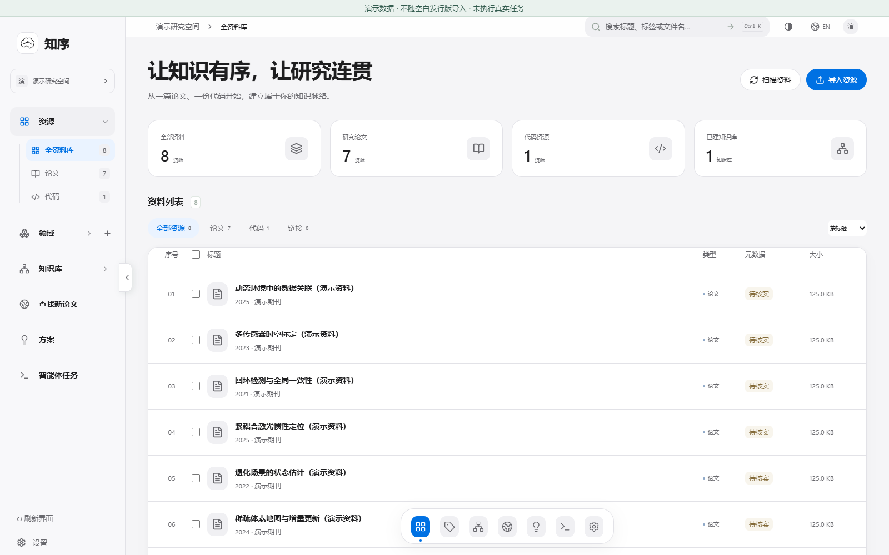
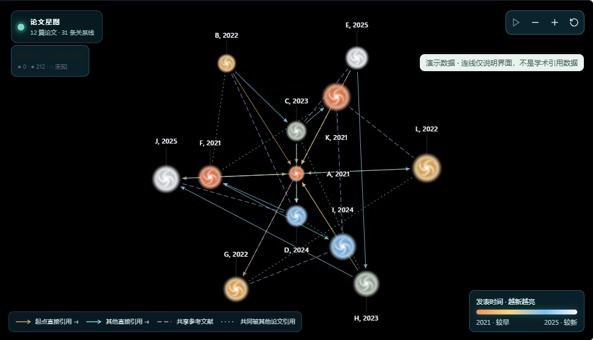
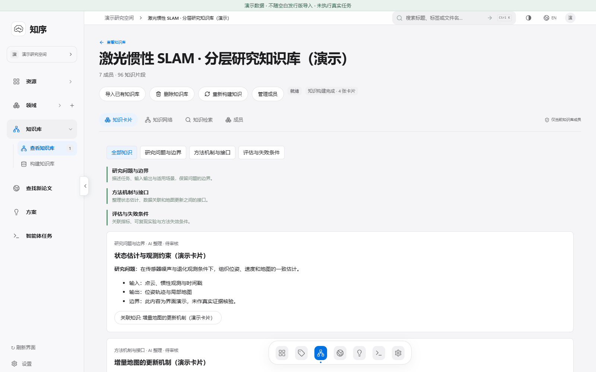
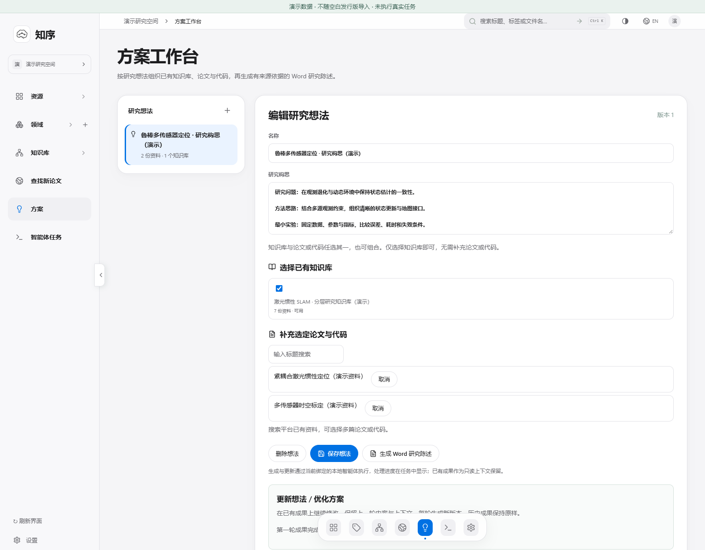

<div align="center">


# 知序 · Knowline

**让论文、代码、知识与科研成果，在一个工作台里连起来。**

A local research workspace for papers, code, knowledge and research outputs.

**Windows x64 · 本地资料管理 · 可追溯知识 · 智能体协作**

[下载空白版](https://github.com/huashu996/KnowLine/archive/refs/heads/main.zip) · [快速开始](#快速开始) · [功能展示](#功能展示) · [English](#english)

</div>



知序面向需要长期积累资料的科研工作：从论文与代码出发，探索文献关系，阅读和标注证据，整理分层知识，再制作方案、公式和可编辑科研图。资源、知识库、任务状态与生成文件保存在本机的同一个项目目录，便于持续使用。

> 当前版本：**2026.10.13 空白发行版**。不预装研究资料、知识库、任务记录、登录信息或智能体绑定。下方截图由当前前端配合演示数据渲染；演示记录不随发行版导入，图中的论文关系与任务状态不代表真实检索或执行结果。

## 从资料到成果

**导入论文与代码 → 探索论文关系 → 阅读与标注 → 整理知识 → 制作科研成果**

| 工作环节 | 知序提供的工具 |
| --- | --- |
| 收集与整理 | PDF、代码项目导入；领域、标签、笔记；内容去重 |
| 文献探索 | 起点论文与自由检索描述；论文星图；书目与引用信息；全文来源记录 |
| 阅读与理解 | PDF 批注、选区、代码行号；正文与公式识别；可编辑图复刻 |
| 知识积累 | 自定义知识层；带来源的知识卡；原文证据检索；知识网络 |
| 研究与输出 | Word 科研方案；动态引用；多轮优化；智能体任务与成果管理 |

## 功能展示

### 1. 一个资源库，组织论文与代码

批量导入 PDF、文件夹、源码或项目目录，以领域和标签组织资料。论文与代码各有阅读入口，后续任务使用明确选定的资源，保留论文页码或代码行号等来源位置。

- 文件选择器导入，代码项目保留目录结构。
- 按内容去重，查看元数据、笔记与资源关系。
- 将资料加入领域，再围绕这个领域建库或制作方案。

### 2. 论文星图：看见相关论文如何连接



从起点论文探索相关工作，也可以补充自然语言侧重点，例如 **“KISS-ICP，以 TRO、RA-L 为主，关注鲁棒性与实时性”**。查看论文详情、来源、引用信息，再选中候选导入资源库。

- **关系分类型：** 直接引用、共享参考文献、共同被引与语义关联分别展示；语义关联不作为真实引用。
- **关系与全文分工：** 关系智能体整理论文关系和引用信息，PDF 智能体寻找对应全文。
- **缺全文仍保留节点：** 单篇 PDF 获取失败不会删除论文或已知关系。引用次数与图内连线数量分别记录。
- **来源状态可见：** 区分已查、未查、限流与已取得全文，便于判断哪些内容需要重试。

检索覆盖取决于数据来源。正式出版信息、引用数量与实际下载的 PDF 版本分别记录；星图不保证涵盖某一领域的全部文献。

### 3. PDF 阅读，把选区变成可用成果

阅读器支持连续页面、缩放、文本高亮与 PDF 批注。**阅读工具位于 PDF 阅读器自身左侧**，可以从论文选区创建正文、公式和科研图任务。

| 选区用途 | 输出形式 |
| --- | --- |
| 识别正文与数学公式 | Word / PowerPoint 正文与可编辑公式 |
| 复刻科研框图 | 可继续修改的 PowerPoint 文字、框体、连接线与图片层 |
| 作为分析依据 | 带资源与页码位置的任务来源 |

复杂图像和无法可靠拆分的内容会保留为独立图片层；不同内容的可编辑程度取决于源图与任务结果。

### 4. 分层知识库，保留结论背后的依据



选择论文与代码，按自己的研究问题定义知识层和侧重点。智能体整理知识卡、方法机制、接口、前提与失败条件，并把主张连接到原文或源码位置。

- 自定义各层名称，增量加入资料并更新知识库。
- 原文证据与整理后的知识卡分别保存，支持回到来源核对。
- 使用原文检索、关键词与语义检索，以及知识网络探索。
- 支持导入包含 `.rag.manifest.json` 的知识库目录；已导入库的语义检索能力取决于实际接入状态。

知识卡中的未核实内容与研究想法需要继续核对；建立索引本身不等于完成知识整理。

### 5. 科研方案与任务工作台，持续推进研究



输入研究想法，选择论文、代码、知识库或其组合，生成 **Word 科研方案**。围绕已有成果继续下一轮优化，保留每轮的来源、说明与产物。

- 复用已连接的本地智能体执行入口，支持多个任务并行。
- 查看任务状态、执行记录、用时、取消控制和成果入口。
- 将实际生成文件与任务来源关联，便于继续阅读、修改和使用。
- 选择并连接目标 Word 文档，插入动态引文与参考文献，更新编号和样式。

智能体任务需要用户连接可重复调用的本地执行客户端。模型可使用该客户端配置的云服务；“本地保存”不表示所有模型推理都离线完成。

## 快速开始

1. **下载并完整解压。** 使用上方“下载空白版”，在解压后的仓库中进入 `Knowline-Windows-x64-2026.10.11/Knowline`；独立发行 ZIP 直接进入 `Knowline` 目录。GitHub 保留原目录名称，内容已更新为当前版本。
2. **打开知序。** 双击 `StartKnowline.cmd`。请保留 `app` 与启动脚本的相对位置，并放在可写目录。
3. **导入资料。** 在资源库选择 PDF、代码或文件夹，按需设置领域与标签。
4. **连接智能体。** 需要分析、建库或生成成果时，在自己的本地 AI 项目中发送：**“将本地智能体连接到知序”**。连接方式见 [本地智能体协议](app/docs/LOCAL_AGENT.md)。
5. **开始研究。** 打开论文阅读器，探索论文星图，或选择资源创建知识库与科研方案；在智能体任务中查看进度与成果。

默认本地服务地址为 `http://127.0.0.1:21867/`，以本实例配置为准。只启动服务可使用 `app/StartServer.cmd`。

## 运行条件

| 条件 | 说明 |
| --- | --- |
| Windows x64 | 桌面窗口需要 Microsoft Edge WebView2 Runtime。发行包自带程序运行依赖，日常使用无需另装 Node.js 或 Python 开发环境。 |
| Word / PowerPoint | 相应 Office 功能需要本机 Windows 桌面版 Office，发行包不包含 Office。 |
| 本地智能体客户端 | 内容理解、知识整理与成果生成需要配置好的执行客户端及对应工具；普通网页聊天窗口不能充当持续执行入口。 |
| 网络与访问权限 | 论文检索和全文获取需要可达的来源与相应权限，无法保证每篇论文都能取得 PDF。 |

## 资料、全文与访问权限

**论文下载先判断账户状态。** 对应出版商会话已认证时尝试正式版 PDF；未认证时直接查公开来源，不先发送订阅下载请求。候选来源包括 arXiv、GitHub、作者仓库等；另提供 Sci-Hub 补充入口，其内容不属于开放许可 OA，使用需遵守适用法律与来源条款。

出版社与公开书目来源用于核对论文信息，Google 学术也提供查询入口。正式发表信息与取得的全文版本分别记录；发现链接不等于下载成功。主要来源无法取得全文时结束该篇的本轮获取，论文节点与关系仍保留。

账户由使用者自行登录，任务按对应站点的实际访问状态处理。论文原始题名、引用原文和已登记文件保留原样，界面支持中英文切换。

## 文件保存在哪里

```text
Knowline/
├── StartKnowline.cmd       # 桌面启动入口
├── app/                   # 程序、运行库、CLI、文档与研究技能
├── resource/              # 首次使用后创建：资料、知识库、索引与任务状态
└── outputs/               # 首次使用后创建：Word、PPT、报告与预览成果
```

空白发行版只包含软件和说明图片。实际资料与成果由使用者导入和生成。存储工具提供用量统计、缓存预算、安全清理预览与元数据检查点；检查点不是完整资料备份。

## 进一步了解

| 文档 | 内容 |
| --- | --- |
| [桌面启动与运行包](app/docs/DESKTOP.md) | 启动入口与运行依赖 |
| [本地智能体连接](app/docs/LOCAL_AGENT.md) | 执行客户端连接与并行任务 |
| [代码项目导入](app/docs/CODE_IMPORT.md) | 源文件、目录结构与代码阅读 |
| [知识卡片与来源](app/docs/KNOWLEDGE_CARDS.md) | 知识整理与来源追溯 |
| [Word 动态引用](app/docs/WORD_CITATIONS.md) | 引文、参考文献与样式 |
| [正式书目与 PDF 版本](app/docs/CITATION_PDF_SEPARATION.md) | 出版信息与全文版本分别记录 |
| [科研方案来源](app/docs/PROPOSAL_SOURCES.md) | 论文、代码与知识库的选择 |
| [CLI / API 协议](app/docs/PROTOCOL.md) | 命令行与本地接口 |
| [第三方许可说明](app/docs/THIRD_PARTY_NOTICES.md) | 运行组件与素材说明 |

## English

**Knowline is a Windows research workspace that connects your papers, code, knowledge and outputs.** Import resources, explore paper relationships, read and annotate PDFs, build layered knowledge cards with source references, and develop research proposals in Word.

- **Paper discovery:** seed papers plus natural-language focus, typed relationships, citation information and separate PDF acquisition. Papers remain in the graph when their PDFs are unavailable.
- **Reading and reuse:** PDF annotations, source-code navigation, editable equations and PowerPoint figure reconstruction from selected regions.
- **Knowledge building:** customizable layers, sourced cards, method details, prerequisites, failure conditions and source-text retrieval.
- **Research workflow:** locally connected agents, concurrent tasks, iterative Word proposals and dynamic Word citations.

**Getting started:** download and fully extract the ZIP. In the GitHub archive, open `Knowline-Windows-x64-2026.10.11/Knowline`; a standalone distribution ZIP opens directly into `Knowline`. Double-click `StartKnowline.cmd`, import your own resources and connect a reusable local execution client when you need agent tasks. See the [connection guide](app/docs/LOCAL_AGENT.md).

The **2026.10.13 blank edition** contains no research library, knowledge bases, task records, account sessions or agent binding. Screenshots render the current frontend with illustrative data, not actual research results. Windows x64 and WebView2 are required; Office features need desktop Word / PowerPoint. Data is stored locally, while a connected client may use a cloud model. Full-text availability depends on network access and permissions; all-paper PDF coverage and complete citation coverage are not guaranteed.
